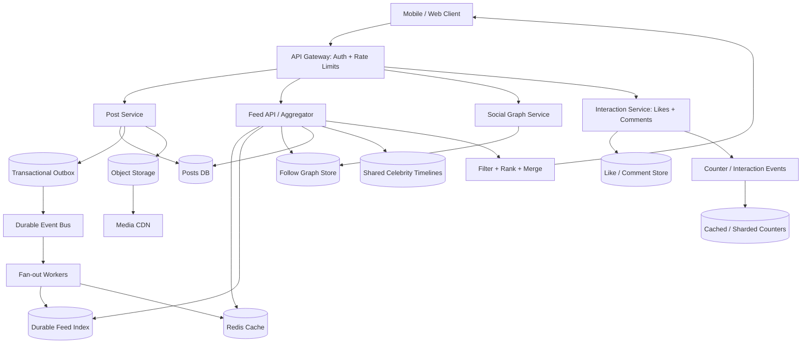

# News Feed System Design — Interview Quick Notes

> Goal: Design a Facebook/Instagram-style feed for millions of users. Focus on the architecture, data access patterns, fan-out, feed latency, and distributed-system edge cases.

## 1. Core idea to remember

**Use hybrid fan-out:**
- **Normal accounts:** fan-out on write (push post IDs into followers' feed indexes asynchronously).
- **Celebrity/high-follower accounts:** fan-out on read (keep a shared author timeline and merge its recent posts into a follower's feed when requested).
- **Feed aggregator:** combines candidates, deduplicates, checks current visibility, hydrates post data, ranks, and returns a cursor-paginated page.

Feed entries normally store **post references/IDs**, not a full copy of the post for every follower.

## 2. Architecture diagram



**Components:**
- **Posts DB:** durable source of truth for post metadata.
- **Follow graph:** relationships and indexes for both `who I follow` and `who follows me`.
- **Feed index:** ordered list of post IDs prepared for a recipient; durable store plus Redis cache for hot/recent entries.
- **Event bus + workers:** asynchronous fan-out, counts, notifications, and cleanup.
- **Object storage + CDN:** photo/video bytes; don't put media bytes in feed database rows.

These are logical components. Start simpler and split services/stores when scale requires it.

## 3. Back-of-the-envelope estimates (example assumptions)

Assume **100M daily active users (DAU)**.

- 15 feed requests/user/day → `100M × 15 = 1.5B feed requests/day`.
- Average feed RPS → `1.5B / 86,400 ≈ 17.4K RPS`.
- At 5× peak → about **87K feed RPS**.
- 10M posts/day → `10M / 86,400 ≈ 116 posts/sec` on average.
- If each post is delivered to 300 followers on average → `10M × 300 = 3B feed-entry writes/day`, or about **34.7K writes/sec average**.
- At 1 KB metadata/post → about `10 GB/day` or `3.65 TB/year` raw metadata, before indexes, replicas, and overhead. Media storage is separate.

These are illustrative assumptions, not actual Facebook/Instagram traffic. Real follower counts are highly skewed, which is why celebrity accounts need special handling.

## 4. Fan-out: push vs. pull

### Push / fan-out on write (ordinary accounts)
1. Save post durably.
2. Publish `PostCreated` event.
3. Workers fetch followers in batches.
4. Insert the post ID into eligible followers' feed indexes.
5. Feed reads can fetch prepared IDs quickly.

**Pros:** fast feed reads. **Cons:** creates many writes; can waste work for inactive followers.

### Pull / fan-out on read (celebrity accounts)
1. Store the post once in the author's timeline.
2. Keep recent timeline data in a shared cache.
3. On a follower's feed request, fetch a bounded set of recent celebrity posts.
4. Merge those candidates with the prepared feed.

**Pros:** avoids writing a post to millions of followers. **Cons:** adds read-time work.

### Tiered hybrid for very large creators
- Push first to an active cohort if useful; pull for other followers.
- Process push jobs in batches with bounded concurrency and retries.
- Share/replicate celebrity timeline cache; use request coalescing to prevent a cache-miss stampede.
- Do not fetch all posts from every followed account. Retrieve bounded recent candidates, then refill if needed.

## 5. Minimal data model / schemas

Relational schema is a good starting point. At larger scale, some high-volume data may be partitioned/sharded or moved to a distributed key-value/wide-column store based on access patterns.

```sql
CREATE TABLE users (
  id BIGINT PRIMARY KEY,
  username VARCHAR(50) UNIQUE NOT NULL,
  is_private BOOLEAN NOT NULL DEFAULT FALSE,
  status VARCHAR(20) NOT NULL DEFAULT 'active'
);

CREATE TABLE posts (
  id BIGINT PRIMARY KEY,
  author_id BIGINT NOT NULL,
  body TEXT,
  visibility VARCHAR(20) NOT NULL DEFAULT 'followers',
  status VARCHAR(20) NOT NULL DEFAULT 'published',
  version BIGINT NOT NULL DEFAULT 1,
  created_at TIMESTAMPTZ NOT NULL DEFAULT NOW(),
  updated_at TIMESTAMPTZ NOT NULL DEFAULT NOW()
);
CREATE INDEX idx_posts_author_time ON posts(author_id, created_at DESC, id DESC);

CREATE TABLE follows (
  follower_id BIGINT NOT NULL,
  followee_id BIGINT NOT NULL,
  status VARCHAR(20) NOT NULL DEFAULT 'active',
  created_at TIMESTAMPTZ NOT NULL DEFAULT NOW(),
  PRIMARY KEY (follower_id, followee_id),
  CHECK (follower_id <> followee_id)
);
CREATE INDEX idx_follows_by_followee ON follows(followee_id, follower_id);

CREATE TABLE post_likes (
  post_id BIGINT NOT NULL,
  user_id BIGINT NOT NULL,
  created_at TIMESTAMPTZ NOT NULL DEFAULT NOW(),
  PRIMARY KEY (post_id, user_id)
);

CREATE TABLE comments (
  id BIGINT PRIMARY KEY,
  post_id BIGINT NOT NULL,
  user_id BIGINT NOT NULL,
  body TEXT NOT NULL,
  status VARCHAR(20) NOT NULL DEFAULT 'published',
  created_at TIMESTAMPTZ NOT NULL DEFAULT NOW()
);
CREATE INDEX idx_comments_post_time ON comments(post_id, created_at DESC, id DESC);
```

**Feed index (conceptual, not necessarily a SQL table):**

```text
FeedEntry: user_id, post_id, author_id, post_created_at, source
Query:     get recent entries for one user, ordered by time / ranking
```

A durable key-value or wide-column store can suit this access pattern at high scale; Redis can cache a bounded recent window. A follow graph also needs both access paths: `follower_id -> followees` and `followee_id -> followers`.

**Transactional outbox:** save the post and its `PostCreated` event in the same DB transaction. A publisher sends the event to the message bus. This avoids saving the post but losing the event if the process crashes.

## 6. Main flows

### Create post

```text
Client -> Post API -> DB transaction (post + outbox)
                    -> return success
Outbox publisher -> Event Bus -> Fan-out workers
                                 -> follower Feed Index (push cohort)
                                 -> shared author timeline (pull source)
```

Return success after the post is durably saved; do not wait for every follower's feed to update. Use an idempotency key so client retries don't create duplicate posts. The author can see their own post immediately.

### Read feed

```text
Client -> Feed API
       -> fetch cached/durable feed IDs
       -> fetch bounded celebrity timeline candidates
       -> merge + deduplicate
       -> batch-load posts/authors/counts/viewer-like state
       -> apply current visibility/privacy checks
       -> rank + diversity rules
       -> return page + opaque cursor
```

Use batch/multi-get operations and parallelize independent reads. Avoid an N+1 query (one database request per feed item). Use ranking fallback (e.g., eligible recent posts) if the ranking service is slow/down.

### Follow / unfollow

- Persist the relationship; private-account follow may require approval.
- On follow, optionally backfill recent posts according to product rules.
- On unfollow/block, invalidate/update caches and clean old feed entries asynchronously.
- **Always verify current visibility/relationship state at read time.** Old feed IDs are not permission to view content.

### Like / unlike / comment

- `PUT /posts/:id/like` = ensure the like exists.
- `DELETE /posts/:id/like` = ensure the like doesn't exist.
- Enforce a unique `(post_id, user_id)` relationship; only emit `+1` or `-1` when state really changes.
- Persist comments individually; paginate them. Never store millions of comments in one post row or load every comment at once.
- Counts, notifications, and analytics can update asynchronously after the durable interaction succeeds.

## 7. Sharding and viral engagement

**Shard = a subset/bucket of data; it is not automatically a physical server.** A database shard usually means data is distributed across database nodes. A logical counter shard can be one counter row/key, and multiple counter shards may live on one server unless the storage system distributes them.

### Sharded counter example

Instead of making all likes update one hot `posts.like_count` row:

```text
post_id = P100
  counter shard 0 -> 10,000
  counter shard 1 -> 10,000
  counter shard 2 -> 10,000
  ...
  counter shard 99 -> 10,000
Total displayed count = sum/aggregate of all counter shards
```

Each shard is one **partial counter bucket** (often a row or key), not one million like records. Incoming counter updates are spread among buckets to reduce contention. The displayed total can lag slightly.

- Keep individual like records separately so the system can answer "Did Alice like this post?" and prevent duplicates.
- Distribute like records across partitions if one viral post creates a hot partition.
- Update a counter only after an actual state transition; duplicate requests/events must not increment twice.
- For unlike, ensure the like existed before applying `-1`.
- Comments are content records, not just counters. Partition hot comment workloads where required; query a bounded set of buckets and merge a page.
- Hashing `user_id % N` is one possible bucket assignment; changing `N` later needs a migration strategy. Do not treat it as a universal design.

## 8. Feed speed and freshness

- Precompute ordinary-user feed entries asynchronously; cache recent IDs for active users.
- Cache popular posts, author profiles/timelines, and engagement aggregates.
- Share hot celebrity timeline data across feed requests; protect cache misses with request coalescing and TTL jitter.
- Hydrate posts/authors/counts in batches; avoid N+1 queries.
- Keep the candidate set bounded, use multi-stage ranking, and set deadlines for optional work.
- Use cursor pagination, not large SQL offsets. For chronological ordering, use a stable `(created_at, post_id)` tie-breaker.
- Prefetch the next page before the user reaches the bottom; lazy-load media from a CDN with suitable image/video variants.
- Freshness target is a design goal: the post can be saved instantly while follower-feed propagation happens a few seconds later. Monitor queue age and propagation delay.

Illustrative warm-cache latency budget (not a measured promise): gateway 10 ms + feed IDs 20 ms + batch hydration/permissions 40 ms + ranking 30 ms + network/serialization margin 50 ms ≈ 150 ms. Measure actual p95/p99 and optimize the critical path.

## 9. Distributed-system edge cases

| Problem | Main mitigation |
|---|---|
| Post saved but event publish fails | Transactional outbox + retrying publisher |
| Event delivered more than once | Idempotent consumers, unique event IDs/keys |
| Worker crashes halfway through fan-out | Retry batches safely; make feed insertion idempotent |
| Like request retried | Unique like record and state-based idempotent API |
| Like/unlike requests arrive out of order | Version/sequence or serialized state transition; reconcile latest intended state |
| One celebrity overwhelms fan-out | Hybrid push/pull, batching, queue backpressure |
| Hot like counter | Multiple counter buckets + async aggregation |
| Cache stampede | Request coalescing, TTL jitter, stale-while-revalidate |
| Deleted/private post remains in a feed index | Authoritative read-time filtering + asynchronous cleanup/tombstone |
| Ranking service is down | Fall back to eligible recent posts |
| New posts cause duplicates during scrolling | Stable cursor, tie-breaker, deduplication; optionally snapshot feed session |
| Queue backlog grows | Monitor event age, scale workers within DB limits, prioritize fresh/active cohort |

## 10. Useful metrics

- Feed API p95/p99 latency and error rate
- Cache hit rate and cache-miss latency
- Fan-out queue age and post propagation latency
- Feed duplicate rate and number of candidates filtered
- Database throughput, latency, partition/hot-key load
- Counter aggregation lag and reconciliation differences
- Delete/privacy-change propagation lag
- Ranking timeout rate and fallback rate

## 11. Interview talk track (short)

"I'd use a hybrid fan-out architecture. Posts are saved durably, with a transactional outbox to publish events safely. Normal users' posts are pushed to followers' feed indexes asynchronously, while high-follower accounts use shared author timelines that are pulled into feeds at read time. The aggregator merges bounded candidates, deduplicates, batch-loads content, enforces current visibility, ranks, and returns cursor-paginated results. Likes/comments are stored separately from derived counters; sharded counter buckets avoid one hot counter row. I'd use idempotent workers, cache protection, read-time authorization, asynchronous cleanup, and ranking fallbacks. I'd scale based on measured p99 latency, queue lag, cache hit rate, and hot partitions."

## Last-minute memory checklist

- **Hybrid fan-out:** push ordinary users; pull celebrity timelines.
- **Feed index stores IDs/references**, not full duplicate post copies.
- **Follow graph:** query both who I follow and who follows me.
- **Durable mutation vs. derived view:** like record is durable; count can lag.
- **One counter shard = one partial counter bucket/row/key**, not necessarily a server.
- **Outbox + idempotency** protects asynchronous delivery.
- **Batch hydration + cache + bounded ranking + cursor paging** keeps feed reads fast.
- **Privacy check at read time**; stale feed entries must not reveal content.
