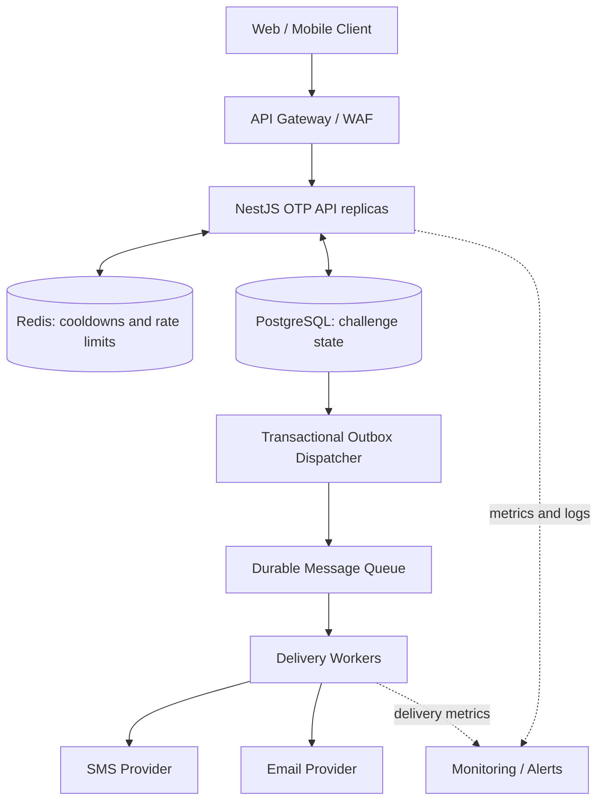

# OTP Service — System Design Interview Notes

> **Goal:** Build a secure, reliable OTP service for signup, login, and password reset. Keep these notes as a quick review before an interview.

## 1. Requirements

- Generate and deliver OTPs through SMS or email.
- Verify the code and enforce expiration.
- Limit verification attempts and resend frequency.
- Prevent brute force, SMS flooding, and repeated requests.
- Handle provider failures and traffic spikes.
- Ensure an OTP can be successfully used only once.

**Example policy:** 6-digit OTP, 5-minute expiry, 5 attempts per challenge, 30-second resend cooldown, plus hourly/daily destination limits. These are example defaults; tune them for the product and risk level.

## 2. Architecture

### Component responsibilities

- **API Gateway/WAF:** TLS, basic bot protection, IP-level request limits.
- **NestJS API:** Generate challenges, validate requests, verify OTPs, enforce business rules.
- **Redis:** Shared resend cooldowns, send quotas, and short-lived abuse counters across API replicas.
- **PostgreSQL:** Authoritative challenge status, expiry, and per-challenge attempt count.
- **Transactional outbox + queue:** Make delivery work durable and decouple API latency from provider latency.
- **Workers:** Send messages, retry temporary failures, and record provider outcomes.
- **Monitoring:** Track failures, latency, abuse and message spend.

## 3. Main data model

### `otp_challenges`

| Field | Why it exists |
|---|---|
| `id` (UUID) | Unpredictable challenge ID |
| `tenant_id`, `subject_id` | Tenant/user boundary, where applicable |
| `purpose` | `signup`, `login`, `password_reset`, etc. |
| `channel` | `sms` or `email` |
| `destination_fingerprint` | Keyed fingerprint of normalized phone/email |
| `code_mac`, `mac_key_version` | Verify the code without storing raw OTP |
| `status` | `pending`, `verified`, `expired`, `locked`, `superseded` |
| `attempts_used`, `max_attempts` | Brute-force protection |
| `expires_at`, `verified_at`, `created_at` | Lifecycle timestamps |

### `otp_delivery_outbox`

Store an event ID, challenge ID, encrypted delivery payload, delivery status, attempt count, next retry time, provider message ID, and timestamps. Insert the challenge and outbox event in **one PostgreSQL transaction**.

**Useful indexes/constraints:** index `expires_at`; index challenge lookup by tenant/subject; enforce at most one pending challenge per destination + purpose + channel (with a partial unique index). Handle expired rows and resend replacements inside transactions.

## 4. OTP generation and storage

- Use a cryptographically secure random number generator (CSPRNG), not `Math.random()`.
- A 6-digit OTP has 1,000,000 possible values; preserve leading zeros by treating it as a string.
- Store a **keyed MAC (HMAC)** of `challengeId + OTP`, not the raw code. Protect the key separately from the database and support key rotation.
- If a delivery worker needs the OTP, keep the delivery payload encrypted and restrict its lifetime/access. Never log the OTP, MAC, or full destination.
- Bind each code to the correct challenge, tenant, destination, purpose, and relevant session/user context.

## 5. Flow: request and send OTP

1. Client calls `POST /v1/otp/challenges` with destination, channel, and purpose.
2. Validate/normalize the destination and validate the allowed purpose.
3. Apply rate limits: IP, device/session, account/identity, destination, tenant/system spending budget.
4. Enforce resend cooldown and idempotency key.
5. Generate OTP + challenge ID; calculate the keyed MAC.
6. In one DB transaction: supersede the previous pending challenge, insert the new challenge, and insert an encrypted outbox event.
7. Return a challenge ID and a generic response appropriate to the use case.
8. Dispatcher publishes the outbox event to the queue; a worker sends the SMS/email.
9. Record provider acceptance and delivery receipts separately when available.

**Important:** A successful API response means the delivery task was recorded; it does not guarantee the SMS reached the handset.

## 6. Flow: verify OTP

1. Client submits `challengeId` and `code`.
2. Apply verification rate limits.
3. Start a PostgreSQL transaction and lock the challenge row (`SELECT ... FOR UPDATE`).
4. Check challenge exists and that status is pending; validate purpose/tenant/session binding.
5. Check server/database time against `expires_at` and check attempts remaining.
6. Recompute and compare the keyed MAC using a constant-time comparison.
7. **Wrong code:** increment `attempts_used`; mark `locked` when the limit is reached; commit.
8. **Correct code:** atomically change `pending` to `verified`, set `verified_at`, and commit.
9. Return a result/grant bound to the original purpose. Consume any follow-up verification grant once.

### Key invariant

**At most one concurrent request can successfully verify a challenge.** The row lock and atomic state transition prevent two simultaneous requests from both accepting the same code. Do not rely on Redis alone for the final verification decision.

## 7. Redis protections (conceptual only)

Use Redis as the **shared, fast admission-control layer** across all NestJS replicas.

- **Cooldown:** one send per destination every 30 seconds.
- **Quota limits:** cap sends per destination/hour and per destination/day.
- **IP/device/account limits:** stop attackers who rotate destination or IP.
- **Cross-challenge verification limits:** new OTPs must not reset all failed-guess protections.
- Use atomic shared operations for checks and counter updates; do not use per-process in-memory counters.
- Keep per-challenge attempt count and challenge status in PostgreSQL as the durable source of truth.
- If Redis is unavailable, do not silently disable rate limits. Use a protected fallback or reject OTP issuance temporarily.

## 8. Back-of-the-envelope estimation (BOE)

**Assumptions:** 10 million OTP challenges/day, 8 million verification requests/day, peak = 10× average, roughly one outbound message per challenge.

| Estimate | Calculation | Result |
|---|---|---:|
| Average sends/sec | 10,000,000 / 86,400 | ~116/sec |
| Peak sends/sec | 116 × 10 | ~1,160/sec |
| Average verifications/sec | 8,000,000 / 86,400 | ~93/sec |
| Peak verifications/sec | 93 × 10 | ~930/sec |
| Logical DB writes/day | 2 writes per challenge + 1 per verification | ~28 million/day |
| Average logical writes/sec | 28,000,000 / 86,400 | ~324/sec |
| Peak logical writes/sec | 324 × 10 | ~3,240/sec |

Assuming ~1 KiB per retained challenge including an index/overhead allowance: 10 GB/day; 30 days ≈ 300 GB logical data, before backups, WAL, replicas and outbox payloads. This is only a starting estimate—validate with realistic load tests and actual PostgreSQL row/index sizes.

**Scaling approach:** Begin with indexed PostgreSQL, Redis, a durable queue, and independently scalable API/worker replicas. Tune connection pooling, indexes and retention before considering sharding. Respect the SMS provider's actual throughput limits.

## 9. Edge cases to mention

- **Concurrent verify:** lock the challenge row; only one success.
- **Concurrent resend:** atomic cooldown/quota plus transactional challenge replacement and unique constraint.
- **Expired code:** reject at verification time; cleanup jobs are just housekeeping.
- **Delayed old SMS:** old challenge is `superseded`, so its code is rejected even if the message arrives late.
- **Provider timeout:** acceptance may be ambiguous. Retry the same delivery task where possible; use provider idempotency if supported.
- **API/client retry:** use an idempotency key to avoid duplicate challenges/messages and to recover lost responses.
- **Redis failover/eviction:** counters may be lost; monitor this and keep durable per-challenge enforcement in the DB.
- **DB or queue failure:** outbox preserves work; retry publishing and use a dead-letter queue for persistent failure.
- **Stale read replica:** verify against the authoritative writer, not a lagging replica.
- **Database growth:** batch-clean old challenges and delete/clear sensitive delivery payloads according to retention policy.
- **Multi-region:** give each challenge one authoritative write region or use strongly consistent state; avoid two regions independently accepting the same challenge.
- **Account enumeration:** use generic responses for login/password-reset flows where appropriate.
- **SMS risks:** SMS can be affected by SIM swaps, interception and phishing; use stronger authenticators for high-assurance login.

## 10. Monitoring

Watch API p95/p99 latency, send/verify rates, delivery acceptance and receipts, queue depth/oldest event age, provider errors, expired-code rate, wrong-code rate, rate-limit rejections, Redis latency/evictions, PostgreSQL lock waits/pool saturation, and SMS spend by tenant/country.

## 11. Interview answer template

> “I would use stateless NestJS API replicas, Redis for distributed cooldowns and rate limits, PostgreSQL as the authoritative challenge store, and a durable queue with delivery workers. The OTP is generated with a CSPRNG and stored as a keyed MAC, while any payload needed for delivery is encrypted. The challenge and outbox event are created in one transaction. During verification, I lock the challenge row, check its purpose, expiry and attempt count, compare the MAC, then atomically mark it verified or increment failures. Redis protects against resend spam and brute force across requests, while PostgreSQL ensures single-use correctness. I would add idempotency, bounded retries, monitoring, retention, and scale the API and workers independently based on measured load.”

## 12. Last-minute checklist

- [ ] CSPRNG; OTP is a string (leading zeros preserved).
- [ ] OTP not stored or logged in plaintext; use keyed MAC.
- [ ] Expiry and purpose/session binding checked every time.
- [ ] Per-challenge attempt limit + cross-challenge rate limits.
- [ ] Resend cooldown + hourly/daily quotas + IP/device controls.
- [ ] PostgreSQL row lock and atomic single-use state transition.
- [ ] Transactional outbox + durable queue + bounded retries.
- [ ] Idempotency for request retries.
- [ ] Monitoring, provider spend limits, cleanup and defined failure policy.
- [ ] BOE peak traffic is calculated; load-test before sharding.
